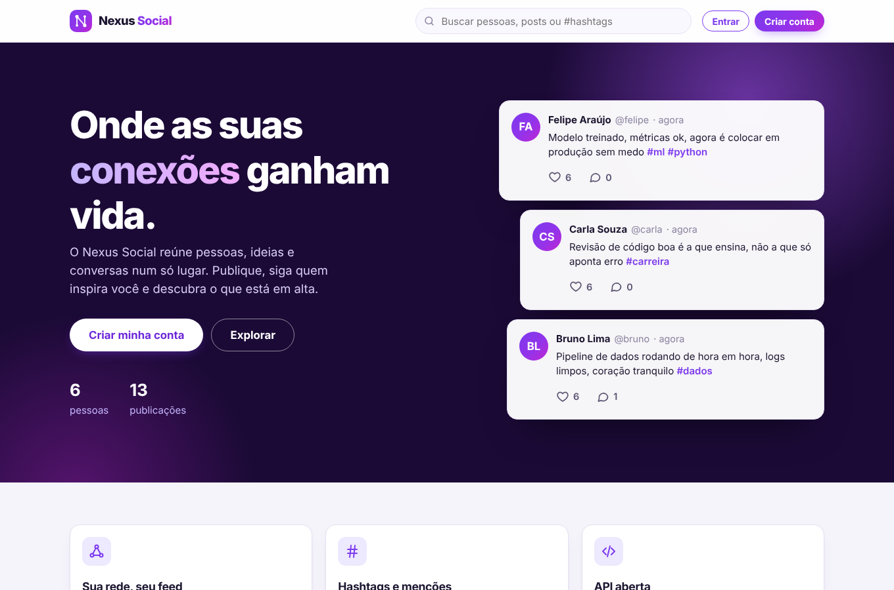
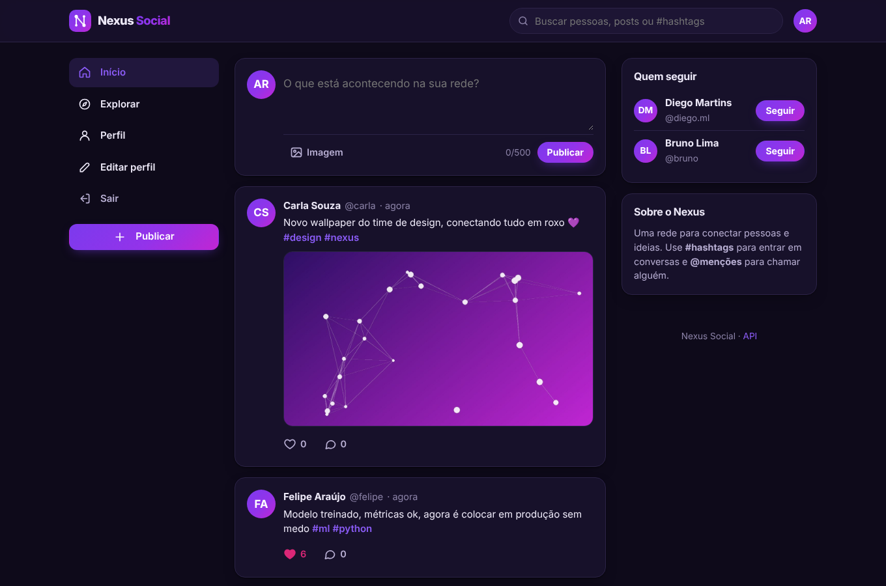
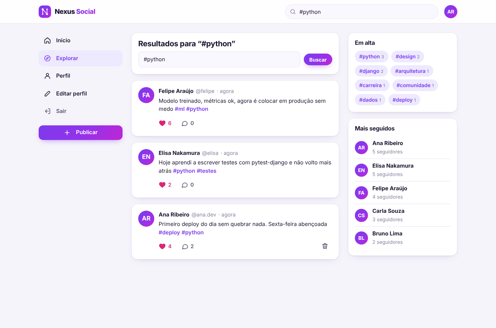
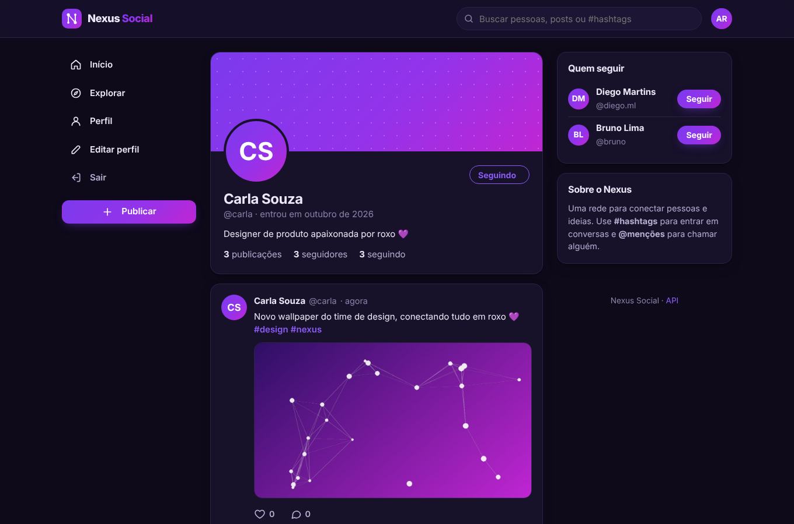
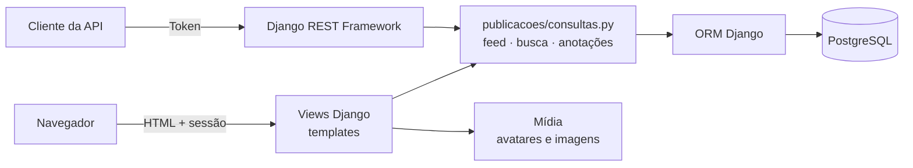

# Nexus Social


Rede social completa em Django, com identidade visual roxa: cadastro e login, perfis com foto,
publicações com imagem, curtidas, comentários, seguidores, feed personalizado, busca por
pessoas e **#hashtags**, **@menções** e uma API REST documentada em OpenAPI.



| Feed (tema escuro) | Explorar e hashtags em alta |
| --- | --- |
|  |  |

| Perfil | Celular |
| --- | --- |
|  |  |

## Funcionalidades

- **Contas**: cadastro com e-mail único, login, logout, edição de perfil (nome, bio e foto).
- **Publicações** de até 500 caracteres, com imagem opcional (até 5 MB) e prévia antes de enviar.
- **Feed** com as publicações de quem você segue, em ordem cronológica e paginado.
- **Curtidas e seguir sem recarregar a página** (JavaScript progressivo: sem JS, tudo continua
  funcionando como formulário comum).
- **Comentários**, que podem ser apagados pelo autor ou pelo dono da publicação.
- **#hashtags e @menções** viram links; a busca por `#python` não traz `#pythonista`.
- **Explorar**: busca de pessoas e posts, hashtags em alta e perfis mais seguidos.
- **API REST** com autenticação por token, paginação, limite de requisições e Swagger em `/api/docs/`.
- Tema claro e escuro automáticos e layout responsivo com barra de navegação inferior no celular.

## Arquitetura



| App | Responsabilidade |
| --- | --- |
| `contas` | Usuário customizado (`AbstractUser`), relação de seguidores, perfil, cadastro |
| `publicacoes` | Publicações, curtidas, comentários, feed, busca, filtros de template |
| `api` | Serializers, viewsets e permissões da API REST |
| `nexus` | Configurações, rotas e health check |

### Decisões de projeto

- **Feed sem N+1.** `publicacoes/consultas.py` monta uma única consulta por página: autor via
  `select_related`, totais de curtidas e comentários via subconsultas e "curti?" via `EXISTS`.
  Há um teste que garante isso com `django_assert_num_queries(1)` para 15 publicações.
- **Regras no banco, não só no código.** `UniqueConstraint` impede curtir ou seguir duas vezes e
  um `CheckConstraint` impede alguém de seguir a si mesmo, mesmo que a aplicação falhe.
- **Segurança.** Todo texto do usuário é escapado antes de virar link (há testes de XSS), os
  redirecionamentos após ações só aceitam URLs do próprio site, uploads têm limite de tamanho,
  e a API só deixa o autor apagar o próprio conteúdo. Em produção (`DJANGO_DEBUG=false`) a
  aplicação recusa subir sem `DJANGO_SECRET_KEY` e liga cookies seguros.
- **Configuração por ambiente** (12-factor): banco via `DATABASE_URL`, SQLite no desenvolvimento
  e PostgreSQL no Docker e no CI.

## Stack

Python 3.12 · Django 5.2 · Django REST Framework · drf-spectacular (OpenAPI) · PostgreSQL ·
Pillow · WhiteNoise · Gunicorn · Pytest · Ruff · mypy (django-stubs) · Docker · GitHub Actions ·
HTML, CSS e JavaScript sem framework

## Como rodar

Com Docker (sobe PostgreSQL e aplicação, aplica as migrações e cria dados de demonstração):

```bash
docker compose up --build
```

Acesse http://localhost:8000 e entre com `ana.dev` / `nexus12345` (ou qualquer usuário da demo).
A documentação da API fica em http://localhost:8000/api/docs/.

Sem Docker, com SQLite:

```bash
python -m venv .venv && source .venv/bin/activate
pip install -e ".[dev]"
python manage.py migrate
python manage.py popular_demo      # opcional: usuários e posts de exemplo
python manage.py runserver
```

## API

| Método | Rota | Descrição |
| --- | --- | --- |
| `POST` | `/api/token/` | Troca usuário e senha por um token |
| `GET` | `/api/publicacoes/?q=&autor=` | Lista publicações (busca por texto ou `#tag`) |
| `POST` | `/api/publicacoes/` | Cria publicação (texto e imagem opcional) |
| `GET` `DELETE` | `/api/publicacoes/{id}/` | Detalha ou exclui (só o autor) |
| `POST` `DELETE` | `/api/publicacoes/{id}/curtida/` | Curte ou descurte (idempotente) |
| `GET` `POST` | `/api/publicacoes/{id}/comentarios/` | Lista ou cria comentários |
| `GET` | `/api/feed/` | Feed do usuário autenticado |
| `GET` | `/api/usuarios/{username}/` | Perfil com contadores |
| `POST` `DELETE` | `/api/usuarios/{username}/seguir/` | Segue ou deixa de seguir |

```bash
TOKEN=$(curl -s -X POST localhost:8000/api/token/ -d username=ana.dev -d password=nexus12345 | jq -r .token)
curl -H "Authorization: Token $TOKEN" -d "texto=Olá pela API #nexus" localhost:8000/api/publicacoes/
curl -H "Authorization: Token $TOKEN" localhost:8000/api/feed/
```

## Testes e qualidade

```bash
pytest --cov            # 74 testes, cobertura de 100%
ruff check . && ruff format --check .
mypy .
```

O CI roda três jobs: lint, tipagem e testes no SQLite; testes e migrações (ida e volta) num
PostgreSQL real; e a aplicação inteira em Docker Compose, conferindo o health check, a página
inicial e a API rodando.

## Licença

MIT
